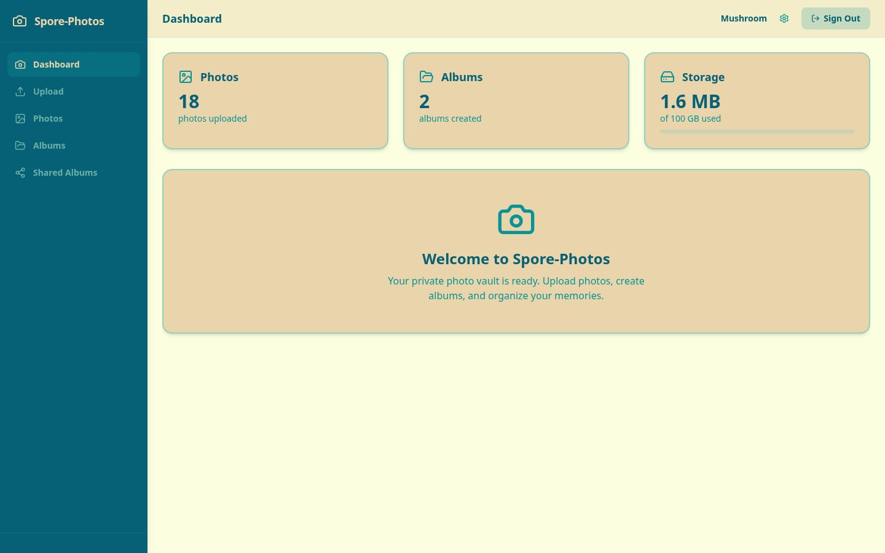
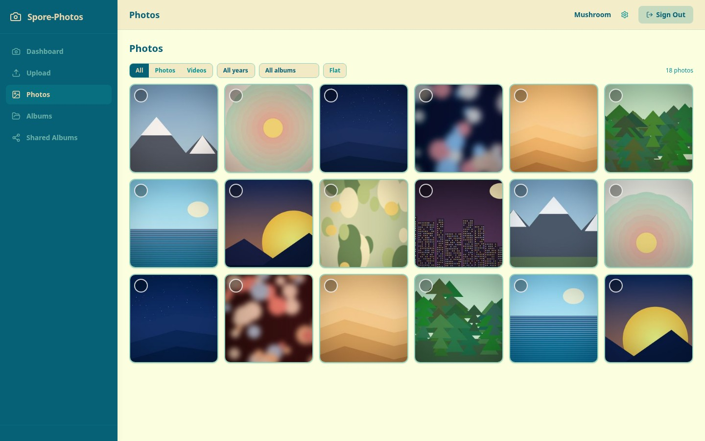
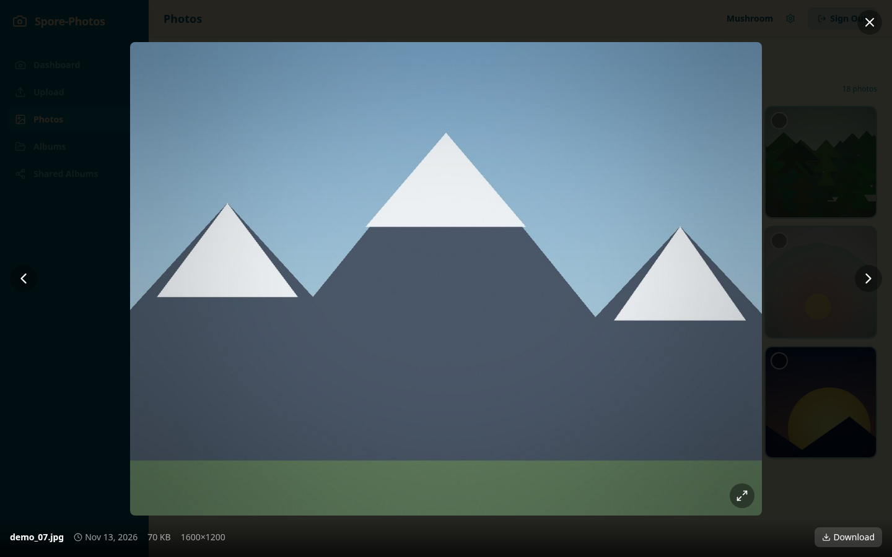
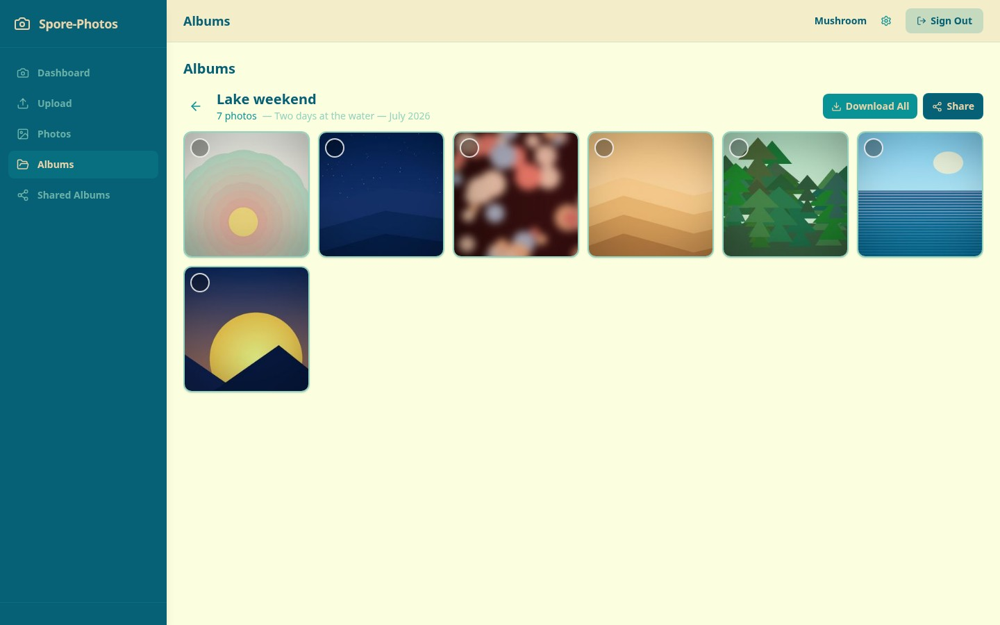
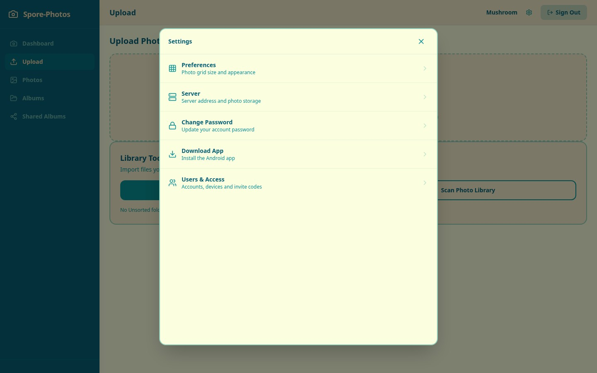
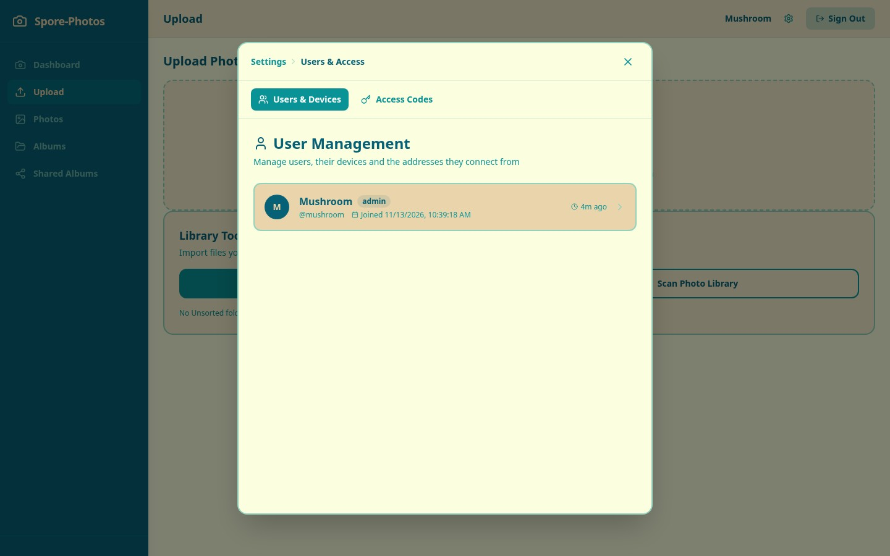
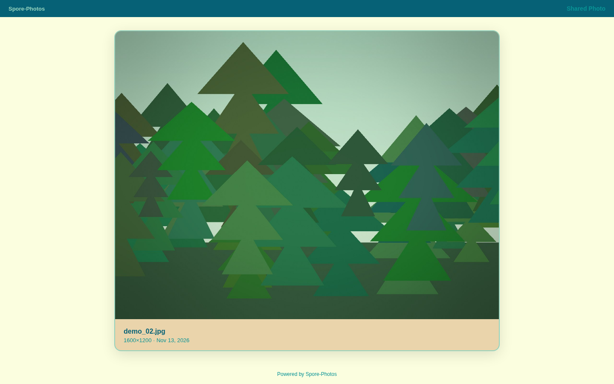
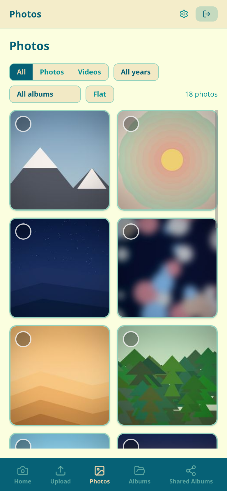

# Spore-Photos

A self-hosted photo library for your own hardware. Albums, sharing, phone
backup, and a native Android app — no third-party cloud, no account with anyone
else, no telemetry.

Released into the public domain ([Unlicense](LICENSE)). Use it, fork it, sell
it, rebrand it; no attribution required.

## What it does

- **Photo library** on your own disk, organised into albums and collections
- **Phone backup** — the Android app uploads new camera-roll photos automatically
- **Sharing** — public read-only links, and album sharing between users on the instance
- **Multi-user** — per-user libraries, invite codes, device management
- **Works offline from the internet** — point the app at a LAN or Tailscale address

## Components

| Component | Port (default) | What it is |
|---|---|---|
| `spore-photos-server` | 4051 | Express API + auth + photo ingest. Also serves the built web UI when `spore-photos-client/dist` exists |
| `spore-photos-public-share` | 4052 | Serves public share links (`/share/<token>`) |
| `spore-photos-client` | built to `dist/` | React 19 + Vite single-page app |
| `spore-photos-mobile` | — | Capacitor Android wrapper for the same web app |

A single deployment config file (`config/spore-photos.config.json`) drives all
of them; see [Configuration](#configuration).

## Screenshots

| | |
|---|---|
|  |  |
|  |  |
|  |  |
|  |  |

The [`screenshots/`](screenshots) folder also has first-run setup, the invite
gate, sign-in, the upload page and the server-settings panel. All of them use a
throwaway demo instance: the photos are generated artwork, not anybody's
library.

## Requirements

- **Node.js 20.19 or newer** (22 LTS recommended for the web build)
- **PostgreSQL 14 or newer**, with a database and role of its own
- **ffmpeg** (and `ffprobe`) for video uploads — images work without it
- A directory for the photo library, writable by the service user (can be a NAS mount)
- Optional: nginx (or any reverse proxy) for HTTPS and a hostname

[`docs/INSTALL.md`](docs/INSTALL.md) covers the full prerequisite list, database
setup, systemd units and upgrades.

## Docker (fastest)

Three containers — API + web UI, public share, PostgreSQL — and one published
port. No host packages beyond Docker:

```bash
./setup                   # from this checkout; choose "Containers"
# or by hand:
cd docker
cp .env.example .env      # set PG_PASSWORD
docker compose up -d --build
docker compose logs api | grep -i "setup token"
```

Full guide, including reverse proxy and Proxmox notes:
[`docs/DOCKER.md`](docs/DOCKER.md).

## Quick start (without Docker)

```bash
# 1. Install dependencies
cd spore-photos-server        && npm ci --omit=dev && cd ..
cd spore-photos-public-share  && npm ci --omit=dev && cd ..
cd spore-photos-client        && npm ci && cd ..

# 2. Create the database and a role for it (as a postgres superuser)
sudo -u postgres psql <<'SQL'
CREATE ROLE spore LOGIN PASSWORD 'choose-a-strong-password';
CREATE DATABASE spore_photos OWNER spore;
SQL

# 3. Configure this deployment
cp config/spore-photos.config.example.json config/spore-photos.config.json
$EDITOR config/spore-photos.config.json      # database password, photo root, ports

# 4. Create the schema
cd spore-photos-server && npm run db:init && cd ..

# 5. Build and start
cd spore-photos-client && npm run build && cd ..
cd spore-photos-server && npm start
# in a second shell:
cd spore-photos-public-share && npm start
```

Open `http://<host>:4051`. Because no account exists yet, the site shows the
**first-run setup** screen. Enter the setup token printed in the server log:

```
── First-run setup required ──
Open the site and enter this setup token: A1B2-C3D4-E5F6-7890-ABCD-EF12
```

Choose the admin username and password there. Nothing is seeded, and there is
no default password.

## Who can sign in

The instance is **invite-only**, and a browser or phone has to be authorised
before it can even show a password form:

1. An admin creates an access code (Settings → Users & Access → Access Codes).
2. You open the site on the new device, enter the code, and either register a
   new account or set a password for an existing one.
3. That device receives a **client token** from the server, which it keeps in
   `localStorage` and sends as `X-Client-Token`. From then on it opens straight
   to your photos.

The IP address is *not* part of the decision — it is recorded for the admin
view and can be blacklisted, nothing more. Signing out ends the session but
keeps the device authorised, so you get the password form rather than a new
access code. Delete a device from the admin panel (or clear its token in
`devices`) to fully revoke it.

If you call the API from a script, send `X-Requested-With: XMLHttpRequest` on
every POST/PUT/PATCH/DELETE: the server requires it as CSRF protection.

## Configuration

One file, read by every service: **`config/spore-photos.config.json`**
(gitignored). Copy the example and edit it:

```bash
cp config/spore-photos.config.example.json config/spore-photos.config.json
```

It has a `default` section plus optional per-environment overrides
(`development`, `production`), selected by `NODE_ENV`:

```json
{
  "default":    { "server": { "port": 4051 }, "database": { "name": "spore_photos" }, "storage": { "picturesRoot": "/srv/photos" } },
  "development": { "server": { "port": 3051 }, "database": { "name": "spore_photos_dev" } }
}
```

Every value can also be supplied as an environment variable, which wins over
the file — see [`.env.example`](.env.example). Point at a different file with
`SPORE_PHOTOS_CONFIG=/path/to/config.json`.

| Key | Env var | Meaning |
|---|---|---|
| `server.port` | `PORT` | API port |
| `server.corsOrigin` | `CORS_ORIGIN` | Only needed when the UI is served from a different origin |
| `server.trustProxy` | `TRUST_PROXY` | `true` **only** behind a proxy you control |
| `publicShare.port` | `PORT` | Public-share port |
| `database.*` | `PG_*` | PostgreSQL connection |
| `storage.picturesRoot` | `PICTURES_ROOT` | Where photos are stored |
| `setup.token` | `SETUP_TOKEN` | Fixed first-run token (otherwise generated) |

**`TRUST_PROXY` matters.** With `false` (the default) the app uses the socket
address and ignores `X-Forwarded-For` / `CF-Connecting-IP`, so a client cannot
forge its address. Set it to `true` only when a reverse proxy you control sets those
headers.

## Where photos are stored

One flat shared library, no per-user directories:

```
<picturesRoot>/<YYYYMM>/<YYYYMMDD>_<uuid>_orig.jpg
<picturesRoot>/<YYYYMM>/<YYYYMMDD>_<uuid>_thumb.jpg   (300 px)
<picturesRoot>/<YYYYMM>/<YYYYMMDD>_<uuid>_prev.jpg    (1200 px)
```

The database stores paths relative to `<picturesRoot>`, so the folder can be
moved. Trees written by older versions (`<username>/<YYYYMM>/…`) are still read;
"Scan Photo Library" reconciles the database with whatever is on disk.

## Version numbers

`VERSION` at the repo root is the single source of truth. The services report it
at `GET /api/health`, the web bundle bakes it in, the Android app derives its
`versionName` and `versionCode` from it, and the UI shows a warning banner when
the server and the bundle disagree — a partial upgrade is visible instead of
silently breaking.

Each release is described by `release.json`, published next to the source. Set
the address of one on the server — `update.sourceUrl` in the config file, or
`UPDATE_SOURCE_URL` in the environment — and the Version & Updates panel reports
when a newer version exists and how *that* install upgrades (Docker compose, or a
manual checkout), with the steps ready to copy. The panel itself is read-only: it
states which address is in use, or that none is, and names the config file.

**Nothing is checked until a source is set.** There is no built-in URL: an
install with no configured source says so and fetches nothing, because choosing
a repository on someone's behalf would mean their server quietly phoning a host
they never picked. When a source is configured, the check runs only as that
panel is opened — nothing polls, nothing phones home on boot, and a fork running
ahead of what the source advertises sees nothing.

`release.json` shape:

```json
{
  "version": "2.0.0",
  "released": "2027-01-15",
  "url": "https://…/releases/tag/v2.0.0",
  "notes": "One line about the release.",
  "upgrade": { "breaking": true, "minFrom": "1.9.0", "migrations": true, "backupFirst": true },
  "android": { "version": "2.0.0", "rebuild": true }
}
```

Only `version` is required; everything else improves what the panel can say. The
`upgrade` block is what a self-hoster needs *before* upgrading, and `android.rebuild`
is set when a release changed the Android shell (the app itself tells you to
rebuild the APK only then — the UI always comes from your server).

## Android app

The app asks for your server's address on first launch (it is not hard-coded to
any domain), so it can talk to a LAN address, a Tailscale IP, or a public
hostname. It loads the whole UI from that server, so a server upgrade reaches
your phone without touching the app at all.

**There is no published app binary.** Build and sign your own APK with
`spore-photos-mobile/scripts/build-apk.sh` — see
[`docs/BUILD-APK.md`](docs/BUILD-APK.md). The key you create is the only one that
can ever update the app you install, which is exactly why it belongs to you and
not to whoever runs the repository.

## Notes on exposure

- Put it behind HTTPS for anything beyond a trusted LAN. Session cookies are
  marked `Secure` whenever the request arrives over HTTPS.
- Do not port-forward the API port directly to the internet if you can avoid
  it — terminate TLS at a proxy and forward to `127.0.0.1`.
- The photo root is read and written by the server process; give it a directory
  it owns.

## Documentation

- [`docs/INSTALL.md`](docs/INSTALL.md) — detailed install, systemd units, nginx
- [`AGENTS.md`](AGENTS.md) — architecture notes for developers and AI agents
- [`spore-photos-mobile/AGENTS.md`](spore-photos-mobile/AGENTS.md) — Android build

## License

[The Unlicense](LICENSE) — public domain.